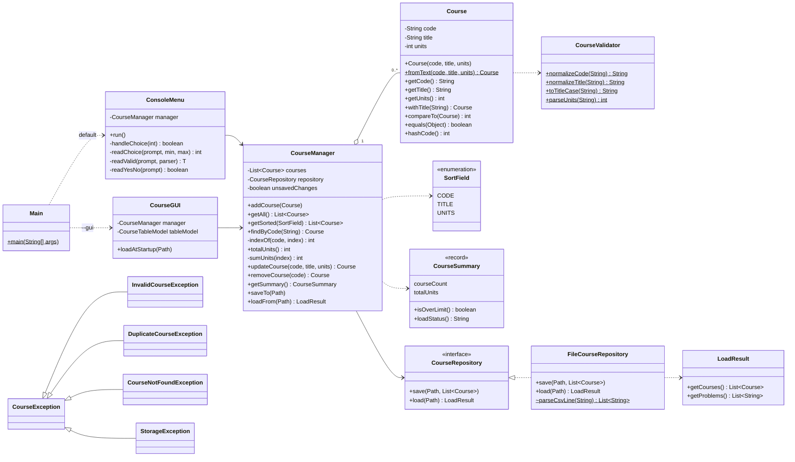
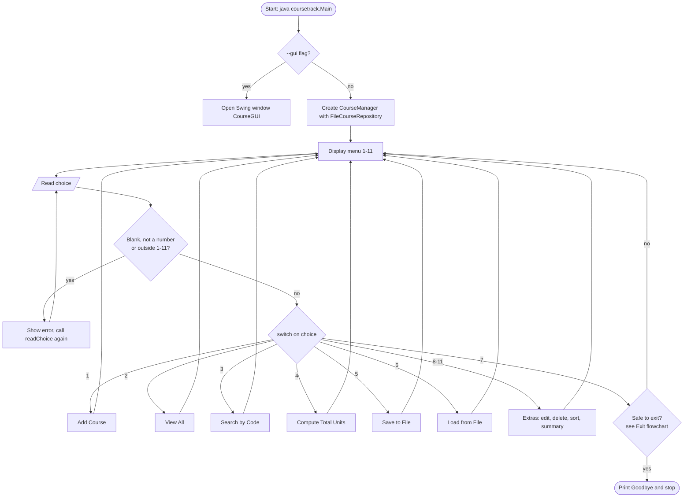
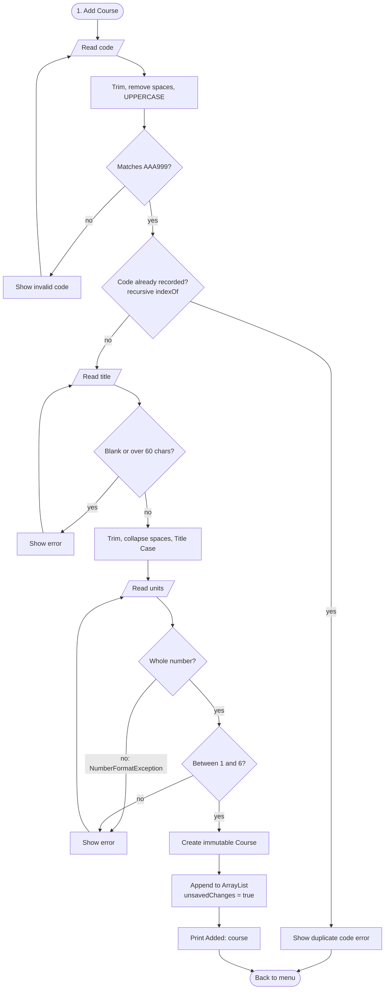
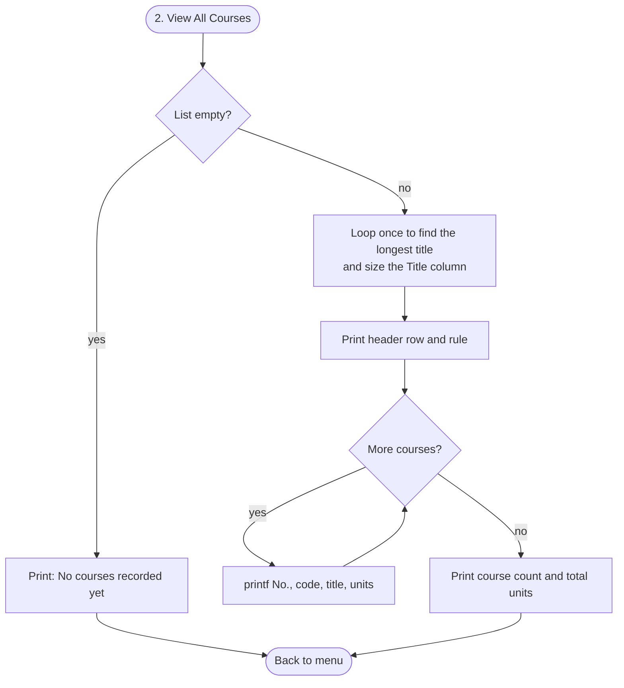
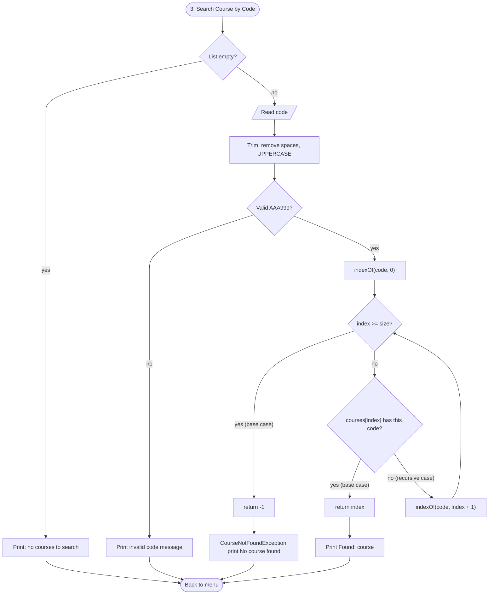
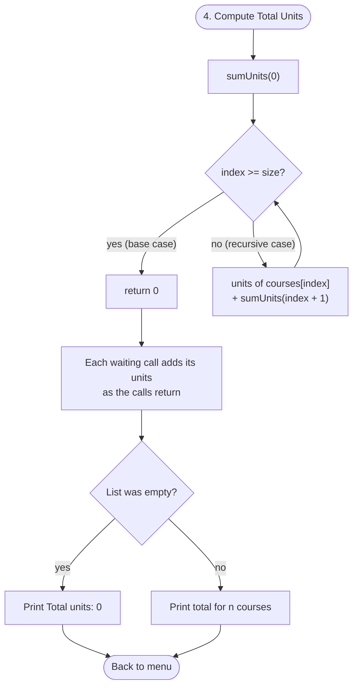
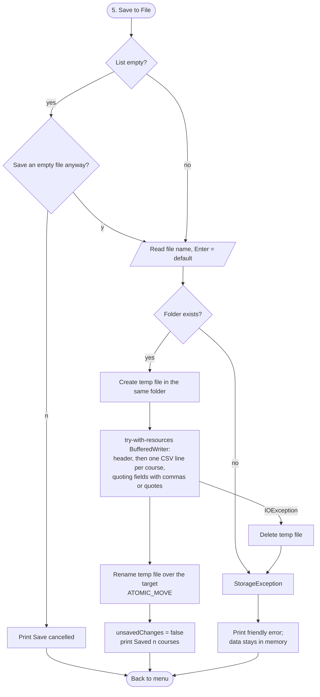
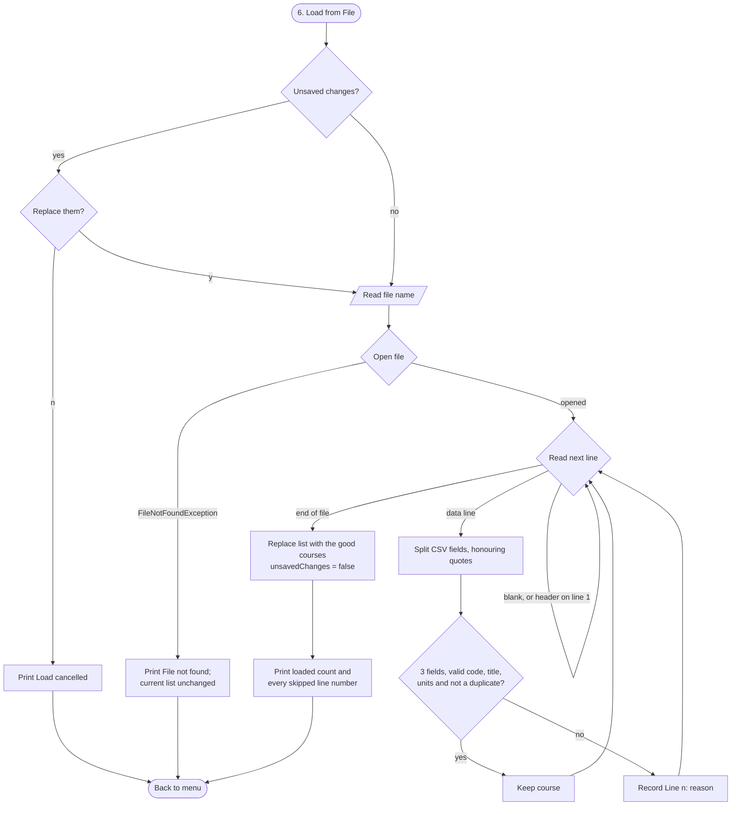
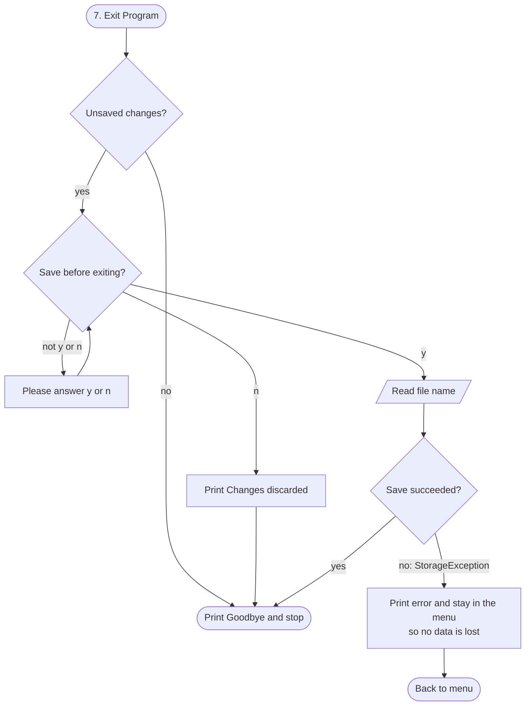

# CourseTrack: Design Document

**Author:** Samuel Ojetunde, B.Sc. Data Science (200 Level, 1st Semester)
**Course:** COS 201 — Computer Programming I, MIVA Open University
**Assessment:** Mid-Semester Lab Assessment, Student Course Management Mini-System ([brief](assignment-brief.md))

This document explains **what** the program must do, **how** it is structured, and **why** it was built that way. It covers the problem definition, the class design, the algorithm, pseudocode and flowchart for each of the seven required operations, the three recursive methods with call traces, the exception and edge-case handling, the design decisions with their trade-offs, and a short Big-O analysis.

---

## Contents

1. [Problem definition](#1-problem-definition)
2. [Architecture and class diagram](#2-architecture-and-class-diagram)
3. [Data format](#3-data-format)
4. [Operations: algorithm, pseudocode and flowchart](#4-operations-algorithm-pseudocode-and-flowchart)
5. [Recursion: base cases, recursive cases and traces](#5-recursion-base-cases-recursive-cases-and-traces)
6. [String processing and validation rules](#6-string-processing-and-validation-rules)
7. [Exceptions and edge conditions](#7-exceptions-and-edge-conditions)
8. [Design decisions and trade-offs](#8-design-decisions-and-trade-offs)
9. [Complexity (Big-O)](#9-complexity-big-o)

---

## 1. Problem definition

A student needs a simple way to record the courses taken in a semester, check them, and keep them between sessions.

| | Description |
|---|---|
| **Inputs** | Menu choices (1-11); a course **code** (e.g. `cos 201`), **title** (e.g. `computer programming i`) and **units** (e.g. `3`); file names for save and load; y/n answers to confirmation questions. In the GUI the same values come from text fields, buttons and a file chooser. |
| **Outputs** | Confirmation messages, an aligned table of courses, search results, the total number of units, a semester summary, a CSV file on disk, and clear error messages for every invalid action. |
| **Processing** | Validate and normalise input, keep courses in an `ArrayList`, search by code, add units recursively, sort, and convert the list to and from CSV text. |
| **Constraints** | Code: 3 letters + 3 digits (`^[A-Z]{3}\d{3}$`) after removing spaces and upper-casing. Title: not blank, at most 60 characters. Units: whole number from 1 to 6. Codes are unique. Normal semester load is 15 to 24 units. Java 17 with no external libraries in the program itself (JUnit is used only by the tests). |
| **Required operations** | 1 Add Course, 2 View All Courses, 3 Search Course by Code, 4 Compute Total Units, 5 Save to File, 6 Load from File, 7 Exit Program. |
| **Extra operations** | 8 Edit Course, 9 Delete Course, 10 Sort / View by code, title or units, 11 Semester Summary. They are labelled "Extra" in the menu so the required 1-7 stay unchanged. |

**Sample data:** [`sample-data/courses.csv`](../sample-data/courses.csv) holds my nine registered courses for this semester: 9 courses, **20 units**.

| Code | Title | Units |
|---|---|---|
| ENT211 | Entrepreneurship and Innovation | 2 |
| MTH201 | Mathematical Methods I | 2 |
| COS201 | Computer Programming I | 3 |
| COS203 | Discrete Structures | 2 |
| DTS201 | Introduction to Data Science | 2 |
| DTS211 | Introduction to R Programming | 2 |
| MTH203 | Set, Logic, and Algebra | 2 |
| MTH209 | Introduction to Numerical Analysis | 2 |
| DTS299 | SIWES I | 3 |

---

## 2. Architecture and class diagram

The code is split into layered packages. Each layer only talks to the layer below it.

| Package | Classes | Responsibility |
|---|---|---|
| `coursetrack` | `Main` | Reads the command-line flags, builds the objects, starts the console or the GUI. |
| `coursetrack.ui.console` | `ConsoleMenu` | Text menu: reads input, decides with a `switch`, prints results. |
| `coursetrack.ui.gui` | `CourseGUI`, `CourseTableModel` | Swing window over the same service. |
| `coursetrack.service` | `CourseManager`, `SortField`, `CourseSummary` | Business rules: unique codes, recursive search and total, sorting, summary, unsaved-change tracking. |
| `coursetrack.storage` | `CourseRepository` (interface), `FileCourseRepository`, `LoadResult` | Saving and loading. The manager only knows the interface. |
| `coursetrack.model` | `Course`, `CourseValidator` | The data object and all string-processing rules. |
| `coursetrack.exception` | `CourseException` and four subclasses | One checked exception type per kind of problem. |



Rendered image: [`diagrams/class-diagram.png`](diagrams/class-diagram.png)

**How a request flows (example: Search).** `ConsoleMenu.handleChoice(3)` calls `searchCourse()`, which reads the code and calls `CourseManager.findByCode("mth 201")`. The manager normalises the code to `MTH201` using `CourseValidator`, runs the recursive `indexOf`, and either returns the `Course` or throws `CourseNotFoundException`. The menu prints the course or the exception's message. The GUI's Search button calls exactly the same `findByCode` method.

---

## 3. Data format

Courses are saved as CSV (comma-separated values) with a header row:

```text
code,title,units
ENT211,Entrepreneurship and Innovation,2
MTH203,"Set, Logic, and Algebra",2
```

- A field that contains a comma or a double quote is wrapped in double quotes, and a quote inside it is written twice (`""`). This is the standard CSV rule (RFC 4180). It is needed for real data: **MTH203 "Set, Logic, and Algebra"** contains two commas, and without quoting it would be read as four fields instead of three.
- The file is read line by line. Each line is split by a small character-by-character parser ([`parseCsvLine`](../src/coursetrack/storage/FileCourseRepository.java#L182)) that remembers whether it is inside quotes.
- Saving is **atomic**: the data is written to a temporary file in the same folder and then renamed over the real file, so a crash part-way through never leaves a half-written file.

---

## 4. Operations: algorithm, pseudocode and flowchart

All seven flowcharts are written in Mermaid below and are also rendered as PNG images in [`docs/diagrams/`](diagrams/).

### 4.0 Main menu loop

**Algorithm.** Build the manager, then repeat: show the menu, read a valid choice (recursive re-prompt), and use a `switch` to run the operation, until the user exits safely.

```text
PROCEDURE main(args)
    IF args contain "--gui" THEN open CourseGUI and STOP
    manager <- new CourseManager(new FileCourseRepository())
    running <- TRUE
    WHILE running DO
        DISPLAY menu (1-7 required, 8-11 extras)
        choice <- readChoice("Enter your choice", 1, 11)
        SWITCH choice
            CASE 1: addCourse()        CASE 2: viewAll()
            CASE 3: searchCourse()     CASE 4: showTotalUnits()
            CASE 5: saveToFile()       CASE 6: loadFromFile()
            CASE 7: running <- NOT confirmExit()
            CASE 8..11: run the extra operation
        END SWITCH
    END WHILE
    DISPLAY "Goodbye!"
END PROCEDURE
```



Code: [`ConsoleMenu.run`](../src/coursetrack/ui/console/ConsoleMenu.java#L76), [`handleChoice`](../src/coursetrack/ui/console/ConsoleMenu.java#L118). Image: [`flow-main-menu.png`](diagrams/flow-main-menu.png)

### 4.1 Add Course

**Algorithm.** Read and validate each field in turn, re-prompting on error. Reject a duplicate code before asking for the title. Create the immutable `Course` and append it to the list.

```text
PROCEDURE addCourse()
    code <- readValid("Course code", normalizeCode)     // re-prompts until valid
    IF manager.containsCode(code) THEN
        DISPLAY "A course with code <code> already exists."
        RETURN
    title <- readValid("Course title", normalizeTitle)
    units <- readValid("Units (1-6)", parseUnits)
    course <- new Course(code, title, units)
    manager.addCourse(course)        // appends, sets unsavedChanges <- TRUE
    DISPLAY "Added: " + course
END PROCEDURE
```



Code: [`ConsoleMenu.addCourse`](../src/coursetrack/ui/console/ConsoleMenu.java#L138), [`CourseManager.addCourse`](../src/coursetrack/service/CourseManager.java#L64). Image: [`flow-add-course.png`](diagrams/flow-add-course.png)

### 4.2 View All Courses

**Algorithm.** If the list is empty say so. Otherwise loop once to find the longest title (so the column is wide enough), then loop again printing one aligned row per course, and finish with the count and total.

```text
PROCEDURE viewAll()
    list <- manager.getAll()            // read-only view
    IF list is empty THEN DISPLAY "No courses recorded yet." ; RETURN
    width <- 30
    FOR EACH c IN list DO width <- MAX(width, LENGTH(c.title))
    PRINT header "No. Code Title Units" using printf widths
    n <- 1
    FOR EACH c IN list DO
        PRINT n, c.code, c.title, c.units  (aligned)
        n <- n + 1
    PRINT count and manager.totalUnits()
END PROCEDURE
```



Code: [`ConsoleMenu.printTable`](../src/coursetrack/ui/console/ConsoleMenu.java#L169), [`CourseManager.getAll`](../src/coursetrack/service/CourseManager.java#L78). Image: [`flow-view-all.png`](diagrams/flow-view-all.png)

### 4.3 Search Course by Code (recursive)

**Algorithm.** Refuse to search an empty list. Normalise the typed code (so the search is case- and space-insensitive) and run the recursive linear search `indexOf`. Index -1 means not found.

```text
PROCEDURE searchCourse()
    IF manager is empty THEN DISPLAY "There are no courses to search." ; RETURN
    text <- readLine("Enter course code")
    TRY
        course <- manager.findByCode(text)
        DISPLAY "Found: " + course
    CATCH InvalidCourseException, CourseNotFoundException AS e
        DISPLAY e.message
END PROCEDURE

FUNCTION findByCode(rawCode)
    code <- normalizeCode(rawCode)          // "mth 201" -> "MTH201"
    index <- indexOf(code, 0)               // recursive, see section 5.1
    IF index = -1 THEN THROW CourseNotFoundException(code)
    RETURN courses[index]
END FUNCTION
```



Code: [`ConsoleMenu.searchCourse`](../src/coursetrack/ui/console/ConsoleMenu.java#L195), [`CourseManager.findByCode`](../src/coursetrack/service/CourseManager.java#L123), [`indexOf`](../src/coursetrack/service/CourseManager.java#L142). Image: [`flow-search-recursive.png`](diagrams/flow-search-recursive.png)

### 4.4 Compute Total Units (recursive)

**Algorithm.** Call the recursive `sumUnits(0)`: the units of the course at the current index plus the sum of the rest. An empty list returns 0 straight away.

```text
PROCEDURE showTotalUnits()
    IF manager is empty THEN DISPLAY "Total units: 0 (no courses recorded yet)"
    ELSE DISPLAY "Total units for " + size + " course(s): " + manager.totalUnits()
END PROCEDURE

FUNCTION totalUnits()
    RETURN sumUnits(0)                      // recursive, see section 5.2
END FUNCTION
```



Code: [`ConsoleMenu.showTotalUnits`](../src/coursetrack/ui/console/ConsoleMenu.java#L212), [`CourseManager.totalUnits`](../src/coursetrack/service/CourseManager.java#L159), [`sumUnits`](../src/coursetrack/service/CourseManager.java#L170). Image: [`flow-total-recursive.png`](diagrams/flow-total-recursive.png)

### 4.5 Save to File

**Algorithm.** Ask for confirmation if the list is empty (to avoid wiping a good file by accident). Ask for a file name (Enter keeps the suggested one). Write the header and one CSV line per course to a temporary file, then rename it over the target.

```text
PROCEDURE saveToFile()
    IF manager is empty AND NOT readYesNo("Save an empty file anyway?") THEN
        DISPLAY "Save cancelled." ; RETURN
    file <- readFileName()                  // blank -> current or default file
    TRY
        manager.saveTo(file)                // unsavedChanges <- FALSE on success
        DISPLAY "Saved n course(s) to file."
    CATCH StorageException AS e
        DISPLAY e.message                   // data is still in memory
END PROCEDURE

PROCEDURE FileCourseRepository.save(file, courses)
    IF folder of file does not exist THEN THROW StorageException
    temp <- create temporary file in the same folder
    TRY-WITH-RESOURCES writer <- BufferedWriter(temp)
        WRITE "code,title,units"
        FOR EACH c IN courses DO WRITE escape(c.code) , escape(c.title) , c.units
    rename temp over file (ATOMIC_MOVE, or a normal replace if not supported)
    ON IOException: delete temp, THROW StorageException
END PROCEDURE
```



Code: [`ConsoleMenu.saveToFile`](../src/coursetrack/ui/console/ConsoleMenu.java#L223), [`CourseManager.saveTo`](../src/coursetrack/service/CourseManager.java#L230), [`FileCourseRepository.save`](../src/coursetrack/storage/FileCourseRepository.java#L51). Image: [`flow-save.png`](diagrams/flow-save.png)

### 4.6 Load from File

**Algorithm.** Warn if loading would replace unsaved changes. Open the file (missing file gives a friendly message and changes nothing). Read it line by line: skip blanks and the header, parse and validate every other line, keep the good ones and record a "Line n: reason" message for each bad one. Only when the whole file has been read is the current list replaced.

```text
PROCEDURE loadFromFile()
    IF manager.hasUnsavedChanges() AND NOT readYesNo("Replace unsaved changes?") THEN
        DISPLAY "Load cancelled." ; RETURN
    file <- readFileName()
    TRY
        result <- manager.loadFrom(file)
        DISPLAY "Loaded k course(s)"
        FOR EACH problem IN result.problems DO DISPLAY problem
    CATCH StorageException AS e
        DISPLAY e.message, "Your current courses are unchanged."
END PROCEDURE

FUNCTION FileCourseRepository.load(file)
    result <- new LoadResult ; seen <- empty HashSet
    TRY-WITH-RESOURCES reader <- BufferedReader(FileReader(file))
        lineNumber <- 0
        WHILE (line <- reader.readLine()) IS NOT NULL DO
            lineNumber <- lineNumber + 1
            IF line is blank OR (lineNumber = 1 AND line is the header) THEN CONTINUE
            TRY
                fields <- parseCsvLine(line)
                IF size(fields) != 3 THEN THROW InvalidCourseException
                course <- Course.fromText(fields[0], fields[1], fields[2])
                IF NOT seen.add(course.code) THEN result.addProblem(lineNumber, "duplicate")
                ELSE result.addCourse(course)
            CATCH InvalidCourseException AS e
                result.addProblem(lineNumber, e.message)
    CATCH FileNotFoundException: THROW StorageException("File not found ...")
    CATCH IOException:           THROW StorageException("Could not read ...")
    RETURN result
END FUNCTION
```



Code: [`ConsoleMenu.loadFromFile`](../src/coursetrack/ui/console/ConsoleMenu.java#L241), [`CourseManager.loadFrom`](../src/coursetrack/service/CourseManager.java#L244), [`FileCourseRepository.load`](../src/coursetrack/storage/FileCourseRepository.java#L104). Image: [`flow-load.png`](diagrams/flow-load.png)

### 4.7 Exit Program

**Algorithm.** If nothing changed since the last save or load, exit. Otherwise ask whether to save (re-prompting until the answer is y or n). If saving fails, stay in the menu so nothing is lost.

```text
FUNCTION confirmExit()
    IF NOT manager.hasUnsavedChanges() THEN RETURN TRUE
    IF NOT readYesNo("You have unsaved changes. Save before exiting?") THEN
        DISPLAY "Changes discarded." ; RETURN TRUE
    file <- readFileName()
    TRY   manager.saveTo(file) ; RETURN TRUE
    CATCH StorageException AS e
        DISPLAY e.message, "Not exiting, so your changes are not lost."
        RETURN FALSE
END FUNCTION
```



Code: [`ConsoleMenu.confirmExit`](../src/coursetrack/ui/console/ConsoleMenu.java#L274); the GUI does the same in [`CourseGUI.exitProgram`](../src/coursetrack/ui/gui/CourseGUI.java#L240), which also runs when the window's close button is clicked. Image: [`flow-exit.png`](diagrams/flow-exit.png)

### 4.8 Extra operations (summary)

| Option | What it does | Code |
|---|---|---|
| 8 Edit Course | Finds the course, asks for a new title and units (Enter keeps the old value), replaces the immutable object with a new one. The code cannot change because it identifies the course. | [`CourseManager.updateCourse`](../src/coursetrack/service/CourseManager.java#L198) |
| 9 Delete Course | Finds the course, asks y/n, removes it. | [`CourseManager.removeCourse`](../src/coursetrack/service/CourseManager.java#L215) |
| 10 Sort / View | Shows a **sorted copy** by code (natural order via `Comparable`), title, or units (highest first, ties by code). The stored order is not changed. | [`CourseManager.getSorted`](../src/coursetrack/service/CourseManager.java#L88), [`SortField`](../src/coursetrack/service/SortField.java) |
| 11 Summary | Course count, total units, and the load status against the normal 15-24 unit range, with a WARNING above 24. | [`CourseManager.getSummary`](../src/coursetrack/service/CourseManager.java#L180), [`CourseSummary`](../src/coursetrack/service/CourseSummary.java) |

With my real courses the summary reports 20 units, "Within the normal load (15-24 units); 4 unit(s) remaining." The over-limit warning is demonstrated by adding a hypothetical 6-unit course (26 units) in [`logs/18-extras-summary-overload.log`](evidence/logs/18-extras-summary-overload.log).

---

## 5. Recursion: base cases, recursive cases and traces

The program uses recursion in three places. Each method has a base case that stops the recursion and a recursive case that moves one step closer to it.

### 5.1 Recursive search: `indexOf(code, index)`

```java
private int indexOf(String code, int index) {
    if (index >= courses.size()) {               // base case 1: past the end, not found
        return -1;
    }
    if (courses.get(index).getCode().equals(code)) {  // base case 2: found it
        return index;
    }
    return indexOf(code, index + 1);             // recursive case: search the rest
}
```

- **Base cases:** the index has passed the end of the list (return -1), or the course at the index has the code (return the index).
- **Recursive case:** search the rest of the list, starting one position later.
- **Why it stops:** every call increases `index` by 1, so it must eventually reach `courses.size()`.
- It is also reused by `addCourse` (duplicate check), `containsCode`, `updateCourse` and `removeCourse`.

**Trace 1:** search for `mth 201` in my course list. It is normalised to `MTH201` first.

```text
indexOf("MTH201", 0)   courses[0] = ENT211  -> not equal, recurse
  indexOf("MTH201", 1) courses[1] = MTH201  -> equal: return 1     (base case 2)
  <- 1
<- 1                     findByCode returns courses[1] = MTH201 - Mathematical Methods I
```

**Trace 2:** search for `PHY101`, which is not recorded (9 courses).

```text
indexOf("PHY101", 0) -> ENT211 no -> indexOf(…, 1) -> MTH201 no -> indexOf(…, 2) -> COS201 no
-> indexOf(…, 3) COS203 no -> indexOf(…, 4) DTS201 no -> indexOf(…, 5) DTS211 no
-> indexOf(…, 6) MTH203 no -> indexOf(…, 7) MTH209 no -> indexOf(…, 8) DTS299 no
-> indexOf("PHY101", 9): 9 >= size 9 -> return -1                    (base case 1)
findByCode sees -1 and throws CourseNotFoundException("PHY101")
```

On an empty list the very first call hits base case 1, which is why searching an empty list is safe (test T17).

### 5.2 Recursive total: `sumUnits(index)`

```java
private int sumUnits(int index) {
    if (index >= courses.size()) {               // base case: nothing left to add
        return 0;
    }
    return courses.get(index).getUnits() + sumUnits(index + 1);   // recursive case
}
```

- **Base case:** the index is past the end, so the sum of "the rest" is 0. This is also why an empty list totals 0.
- **Recursive case:** the units of this course plus the total of all courses after it.

**Trace** with my nine courses (units 2, 2, 3, 2, 2, 2, 2, 2, 3). The calls go down first; the additions happen as each call returns:

```text
sumUnits(0) = 2 (ENT211) + sumUnits(1)
  sumUnits(1) = 2 (MTH201) + sumUnits(2)
    sumUnits(2) = 3 (COS201) + sumUnits(3)
      sumUnits(3) = 2 (COS203) + sumUnits(4)
        sumUnits(4) = 2 (DTS201) + sumUnits(5)
          sumUnits(5) = 2 (DTS211) + sumUnits(6)
            sumUnits(6) = 2 (MTH203) + sumUnits(7)
              sumUnits(7) = 2 (MTH209) + sumUnits(8)
                sumUnits(8) = 3 (DTS299) + sumUnits(9)
                  sumUnits(9) = 0                       <- base case
                returns 3
              returns 5
            returns 7
          returns 9
        returns 11
      returns 13
    returns 16
  returns 18
returns 20                                               <- total units = 20
```

The same result appears in the real run [`logs/04-total-units.log`](evidence/logs/04-total-units.log): "Total units for 9 course(s): 20".

### 5.3 Recursive input re-prompt: `readChoice`, `readValid`, `readYesNo`

The brief suggests "a recurring menu display" as a recursive feature. The console prompts call themselves again when the input is not acceptable:

```java
private int readChoice(String prompt, int min, int max) {
    String text = readLine(prompt);
    if (text.isEmpty()) {                         // recursive case: blank
        error("Please type a number.");
        return readChoice(prompt, min, max);
    }
    int value;
    try {
        value = Integer.parseInt(text);
    } catch (NumberFormatException e) {           // recursive case: not a number
        error("\"" + text + "\" is not a number. Please enter " + min + " to " + max + ".");
        return readChoice(prompt, min, max);
    }
    if (value < min || value > max) {             // recursive case: out of range
        error(value + " is out of range. Please enter " + min + " to " + max + ".");
        return readChoice(prompt, min, max);
    }
    return value;                                 // base case: valid choice
}
```

- **Base case:** the input is valid, so the value is returned.
- **Recursive case:** the input is blank, not a number, or out of range, so an error is shown and the method calls itself to ask again.
- `readValid(prompt, parser)` does the same for code, title and units: the base case is "the parser accepted the text", and the recursive case is "the parser threw `InvalidCourseException`". `readYesNo` accepts only y/yes/n/no.

**Trace** from the real run [`logs/08-invalid-menu.log`](evidence/logs/08-invalid-menu.log), with inputs `abc`, blank, `0`, `15`, `2.5`, `4`:

```text
readChoice -> "abc"  not a number  -> readChoice
  -> ""     blank                  -> readChoice
    -> "0"    out of range         -> readChoice
      -> "15"   out of range       -> readChoice
        -> "2.5"  not a number     -> readChoice
          -> "4"    valid: return 4                         <- base case
```

**Why recursion is acceptable here:** each bad answer adds one stack frame. A person would need to type thousands of invalid answers in a row to cause a `StackOverflowError`, and if the input stream ends (end of file) the method stops with a clean "Input ended" message instead of recursing (test T44). A `while` loop would work equally well; recursion was chosen because the brief asks for it and the method reads naturally as "if it is wrong, ask again".

---

## 6. String processing and validation rules

All rules live in one class, [`CourseValidator`](../src/coursetrack/model/CourseValidator.java), so the console, the GUI and the file loader behave identically.

| Rule | Example | Code |
|---|---|---|
| Trim every input line | `"  4 "` → `4` | [`ConsoleMenu.readLine`](../src/coursetrack/ui/console/ConsoleMenu.java), `trim()` in each validator |
| Code: remove all whitespace, UPPERCASE, check `^[A-Z]{3}\d{3}$` | `"cos 201"` → `COS201`; `"cs 21"` rejected | [`normalizeCode`](../src/coursetrack/model/CourseValidator.java#L48) |
| Title: trim, collapse repeated spaces, not blank, at most 60 characters | `"discrete   structures"` → `Discrete Structures` | [`normalizeTitle`](../src/coursetrack/model/CourseValidator.java#L70) |
| Title Case, with joining words (and, of, to, for, ...) kept lower case unless first | `"set, logic, AND algebra"` → `Set, Logic, and Algebra` | [`toTitleCase`](../src/coursetrack/model/CourseValidator.java#L95) |
| Roman numerals kept in capitals | `"mathematical methods i"` → `Mathematical Methods I` | `ROMAN_NUMERAL` pattern |
| A 2-5 letter word typed fully in capitals is kept as an acronym | `"SIWES i"` → `SIWES I` | `ACRONYM` pattern |
| Single letters are capitalised | `"introduction to r programming"` → `Introduction to R Programming` | first-letter rule |
| Units: `Integer.parseInt` inside `try/catch NumberFormatException`, then range 1-6 | `"two"`, `"2.5"`, `0`, `9` rejected | [`parseUnits`](../src/coursetrack/model/CourseValidator.java#L145) |
| Case-insensitive search | `"mth 201"` finds `MTH201` | [`findByCode`](../src/coursetrack/service/CourseManager.java#L123) |
| Commas and quotes in titles survive save/load | `"Set, Logic, and Algebra"` written as `"Set, Logic, and Algebra"` in quotes | [`escape`](../src/coursetrack/storage/FileCourseRepository.java#L167), [`parseCsvLine`](../src/coursetrack/storage/FileCourseRepository.java#L182) |
| Byte-order mark removed (Excel and PowerShell add one) | `code,...` reads correctly | `FileCourseRepository.load`, `ConsoleMenu.readLine` |

---

## 7. Exceptions and edge conditions

### 7.1 Exception hierarchy

```text
Exception
 └── CourseException                (checked: the compiler forces callers to handle it)
      ├── InvalidCourseException    bad code, title or units; bad CSV line
      ├── DuplicateCourseException  code already recorded
      ├── CourseNotFoundException   search/edit/delete of a code that is not there
      └── StorageException          file missing, unreadable or unwritable (wraps the IOException)
```

The UI catches `CourseException` (or a specific subclass), prints `getMessage()`, and carries on. The original `IOException` is kept as the `cause` of `StorageException`, so no technical detail is lost.

### 7.2 Every edge condition and how it is handled

| # | Condition | Handling | Evidence |
|---|---|---|---|
| E1 | Menu input is letters, blank, a decimal, or out of range (0, 15) | `readChoice` shows a specific message and re-prompts recursively | T37, [`08-invalid-menu.log`](evidence/logs/08-invalid-menu.log), [screenshot](screenshots/error-invalid-menu-choice.png) |
| E2 | Invalid code (`cs 21`, `cos2011`) | `InvalidCourseException`, re-prompt | T03, T38, [`09-field-validation.log`](evidence/logs/09-field-validation.log) |
| E3 | Blank or over-long title | `InvalidCourseException`, re-prompt | T06, T38 |
| E4 | Units not a whole number (`two`, `2.5`) | `NumberFormatException` caught and turned into `InvalidCourseException`, re-prompt | T07, T38 |
| E5 | Units out of range (0, 9) | `InvalidCourseException`, re-prompt | T08, T38 |
| E6 | Duplicate code (any case or spacing) | Refused before the title is asked; `DuplicateCourseException` in the manager | T13, T39, [`16-duplicate-code.log`](evidence/logs/16-duplicate-code.log) |
| E7 | Search / edit / delete when the list is empty | Friendly message, no prompt | T17, T40, [`10-empty-list.log`](evidence/logs/10-empty-list.log) |
| E8 | Search for a code that is not recorded | `CourseNotFoundException` → "No course found with code PHY101." | T16, T40, [`03-search.log`](evidence/logs/03-search.log) |
| E9 | Total of an empty list | Base case returns 0: "Total units: 0" | T19, [`10-empty-list.log`](evidence/logs/10-empty-list.log) |
| E10 | Save with an empty list | Asks for confirmation; if saved, the file holds only the header | T29, [`10-empty-list.log`](evidence/logs/10-empty-list.log) |
| E11 | Load a missing file | `FileNotFoundException` → `StorageException` "File not found", current list unchanged | T30, T43, [`15-load-missing-file.log`](evidence/logs/15-load-missing-file.log) |
| E12 | Corrupted lines (bad code, bad units, wrong field count, unclosed quote, duplicate) | Each is skipped and reported with its line number; good lines are kept | T31, [`14-load-corrupted-file.log`](evidence/logs/14-load-corrupted-file.log) |
| E13 | Load would replace unsaved changes | Warning with y/n; "n" keeps the current data | T42, [`11-load-unsaved-warning.log`](evidence/logs/11-load-unsaved-warning.log) |
| E14 | Exit with unsaved changes | Offers to save; a failed save keeps the program open | T41, [`07-exit-unsaved.log`](evidence/logs/07-exit-unsaved.log) |
| E15 | I/O error while writing (e.g. folder missing, disk full) | `IOException` → temp file deleted → `StorageException`; old file untouched | T34, T26, T33 |
| E16 | Input stream ends unexpectedly (piped script runs out) | Clean "Input ended. Exiting CourseTrack." instead of a crash | T44 |
| E17 | Titles with commas or quotes | CSV quoting and escaping | T28, T35, T45, [`13-round-trip.log`](evidence/logs/13-round-trip.log) |
| E18 | Other code trying to change the list directly | `getAll()` returns an unmodifiable view → `UnsupportedOperationException` | T14 |

---

## 8. Design decisions and trade-offs

| Decision | Why | Trade-off |
|---|---|---|
| **`ArrayList<Course>`** for storage | Keeps the order the student entered; fast access by index, which the index-based recursion needs; simple to explain. A semester has about 10 courses, so speed is not an issue. | Search is linear (O(n)). A `HashMap<String, Course>` would give O(1) lookup but loses the entry order and would make the recursive search pointless. |
| **Immutable `Course`** (`private final` fields, no setters) | Once validated it can never become invalid; it can be handed to the GUI table safely. | "Edit" must build a new object (`withTitle`, `updateCourse`), which is a little more code. |
| **`equals`/`hashCode` on the code only; `Comparable` by code** | Matches the rule "codes are unique". Lets `HashSet` detect duplicates in the file loader and `List.indexOf`/`remove` find a course. Natural order = sort by code. | Two courses with the same code but different titles count as equal, which is intended. |
| **`CourseRepository` interface** | The manager does not care whether data is in CSV, JSON or a database. Tests replace it with an in-memory fake (`CourseManagerTest.FakeRepository`), so the business rules are tested without touching the disk. | One extra small file. |
| **Read-only view from `getAll()`** | Other classes cannot add or remove courses behind the manager's back, which would skip validation and the unsaved-changes flag. | Callers that want to change the list must go through the manager, which is the point. |
| **Checked exception hierarchy** | The compiler forces both UIs to handle every failure; each type maps to one kind of problem, and one `catch (CourseException e)` can handle them all. | More `throws` clauses in method signatures. |
| **CSV with quoting, atomic save** | Opens in Excel; handles real titles with commas; a crash cannot corrupt the saved file. | A hand-written parser (about 30 lines) instead of a library, because the program uses no external libraries. |
| **Recursion** for search, total and re-prompting | Required by the brief; each one has a clear base case and gets one step smaller each call. | Uses one stack frame per element. Fine for a semester list (T20 runs 200 courses safely), but a loop would be better for very large lists. |
| **One validator class** | Console, GUI and file loader apply identical rules. | None significant. |
| **Two UIs over one service** | Shows the layering works: the GUI was added without changing any business rule. | The GUI is deliberately simple. |
| **Javadoc** | Every public class and method has Javadoc comments. The HTML is not committed (it would add hundreds of generated files); generate it with `javadoc -d docs/api -sourcepath src -subpackages coursetrack`. | Readers browse the comments in the source instead. |

---

## 9. Complexity (Big-O)

*n* = number of courses.

| Operation | Time | Space | Reason |
|---|---|---|---|
| Add course | O(n) | O(1) | The duplicate check is a linear search; the append itself is amortised O(1). |
| View all | O(n) | O(1) | Two passes over the list (width, then rows). |
| Search by code (`indexOf`) | O(n) | O(n) stack | One recursive call per course in the worst case (not found). |
| Total units (`sumUnits`) | O(n) | O(n) stack | One recursive call per course; a loop would use O(1) space. |
| Sort (`getSorted`) | O(n log n) | O(n) | Copies the list, then `List.sort` (TimSort). |
| Edit / delete | O(n) | O(1) | Find by code, then replace or remove (removal shifts later items). |
| Save | O(n) | O(1) extra | One line written per course. |
| Load | O(n · L) | O(n) | Every character of every line (length L) is read once; the `HashSet` makes the duplicate check O(1) per line. |
