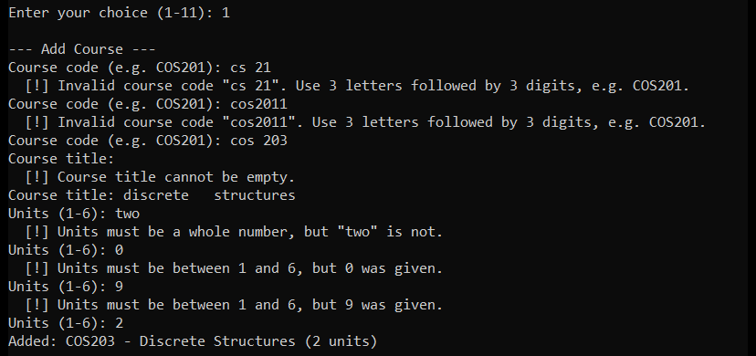
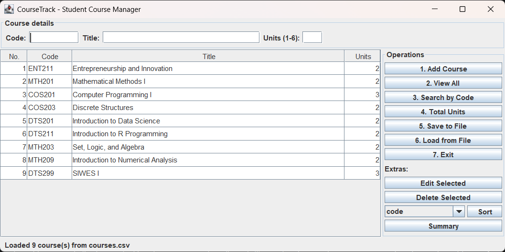

# CourseTrack: Student Course Management System

**Samuel Ojetunde** · B.Sc. Data Science, Year 2 · **COS 201 — Computer Programming I** · MIVA Open University 
Mid-Semester Lab Assessment · Source code: <https://github.com/samjay8/CourseTrack>

## 1. What the system does

CourseTrack is a Java 17 program that helps a student record and manage the courses taken in a semester. It offers the seven required operations (Add Course, View All Courses, Search Course by Code, Compute Total Units, Save to File, Load from File, Exit) through an organised console menu, and the same operations through a simple Swing window (`--gui`). Four clearly labelled extras are added: edit, delete, sort by code/title/units, and a semester summary that warns when the load goes above 24 units. Tested with my own registration (9 courses), it reports **20 units**, within the normal 15–24 range.

## 2. How each major feature works

The code is split into layered packages. `model.Course` is an **immutable** object (private final fields, no setters) whose `equals`, `hashCode` and `compareTo` use the course code, because codes are unique. `service.CourseManager` holds the courses in an `ArrayList`, enforces the rules, and returns only a read-only view of the list. Storage is reached through the `CourseRepository` **interface**, implemented by `FileCourseRepository`, so the file format could change without touching the menu or the GUI. Both interfaces call the same manager methods.

- **Add:** each field is validated by `CourseValidator`. The code is trimmed, spaces removed and upper-cased (`cos 201` → `COS201`) and must match `^[A-Z]{3}\d{3}$`; the title is trimmed and put in Title Case that keeps *and/of/to* lower case, Roman numerals (*I*) and acronyms (*SIWES*); units must be a whole number from 1 to 6. A duplicate code is refused before the title is asked.
- **View All:** prints an aligned table whose title column is as wide as the longest title, followed by the course count and total.
- **Search** and **Total:** recursive methods (section 4); search is case-insensitive.
- **Save:** writes a CSV file with a header. Titles containing commas are quoted, so *"Set, Logic, and Algebra"* survives a save and reload unchanged. The data goes to a temporary file that is then renamed over the real file, so a crash cannot leave a half-written file.
- **Load:** reads the file line by line, keeps every valid course and reports each bad line by number (for example *"Line 4: Units must be a whole number"*).
- **Exit:** if there are unsaved changes, the program offers to save first.

*Figure 1: Real console run. Each invalid value is explained and asked for again until it is valid.*

## 3. Challenges encountered and how errors were handled

I created a small **checked exception hierarchy**: `CourseException` with the subclasses `InvalidCourseException`, `DuplicateCourseException`, `CourseNotFoundException` and `StorageException`. Because they are checked, the compiler forces both interfaces to handle them, and each error reaches the user as a clear message instead of a stack trace. The main challenges were:

1. **Bad keyboard input.** Letters, blank lines, decimals or out-of-range numbers at the menu would crash a naive `Integer.parseInt`. `NumberFormatException` is caught and the user is asked again.
2. **Commas in titles.** A plain comma split would break *"Set, Logic, and Algebra"*. I applied the standard CSV quoting rule and wrote a small character-by-character parser that remembers when it is inside quotes.
3. **Damaged or missing files.** A `FileNotFoundException` becomes a friendly "File not found" message and the current list is kept. A corrupted line does not stop the load: it is skipped and reported by line number.
4. **Losing work.** The program tracks unsaved changes, warns before a load replaces them, offers to save on exit, and stays open if that save fails.
5. **Edge cases.** Searching an empty list, a total of 0, saving an empty list (confirmation required) and input that ends early are all handled.

The work is backed by **45 passing JUnit 5 tests**, 18 scripted console sessions and 13 GUI checks, each with recorded output and screenshots (see `docs/testing.md`).

*Figure 2: The Swing GUI with my nine registered courses loaded from `sample-data/courses.csv`.*

## 4. Where recursion was applied

1. **Search, `CourseManager.indexOf(code, index)`:** *base cases*: the index has passed the end (return −1, not found), or the course at the index has the code (return the index). *Recursive case*: `indexOf(code, index + 1)`. Searching `MTH201` in my list makes two calls and returns index 1.
2. **Total units, `CourseManager.sumUnits(index)`:** *base case*: index past the end returns 0 (which also makes an empty list total 0). *Recursive case*: `units(index) + sumUnits(index + 1)`. With my courses the calls unwind as 3, 5, 7 … 18, **20**.
3. **Input re-prompting, `ConsoleMenu.readChoice`, `readValid` and `readYesNo`:** *base case*: valid input is returned. *Recursive case*: the error is shown and the method calls itself to ask again (the "recurring menu display" suggested in the brief).

Each call moves one step closer to its base case, so the recursion always ends. Full traces, flowcharts and pseudocode are in `docs/design.md`.
